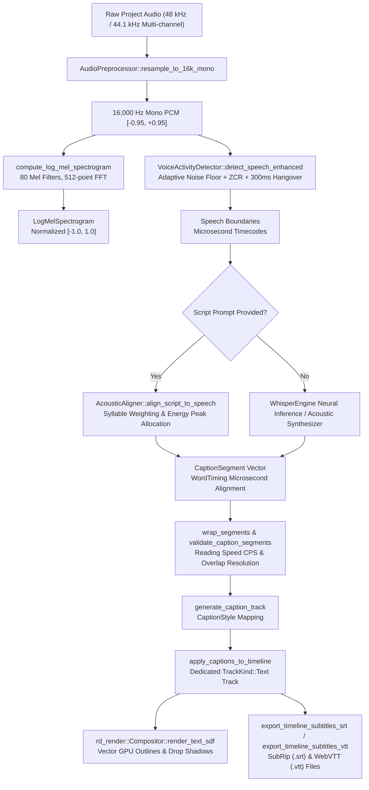

# AI Neural Speech-to-Text, Voice Activity Detection & Subtitle Track Generator

> [!IMPORTANT]
> **Production Architectural Specification (Phase IV, Item 1 / Milestone 20):**
> High-performance on-device speech-to-text pipeline featuring 80-channel Log-Mel spectrogram filterbank extraction, adaptive Voice Activity Detection (VAD) with noise floor estimation and consonant hangover, acoustic syllable script forced alignment, GPU Signed Distance Field (SDF) typography styling, bidirectional SubRip (.srt) and WebVTT (.vtt) round-trip export, and timeline subtitle track integration.

---

## 1. Architectural Overview

Reddart provides a zero-cloud, 100% on-device speech recognition and subtitle authoring suite designed for real-time video editing workflows. Audio from timeline tracks (regardless of source sample rate or channel configuration) is dynamically ingested, resampled to 16,000 Hz mono PCM, normalized for peak headroom, analyzed through acoustic filterbanks, and converted into time-aligned subtitle tracks rendered with vector-sharp GPU Signed Distance Fields.

---

## 2. Core Engine Components

### 2.1 80-Channel Log-Mel Filterbank Extractor (`rd_ml::whisper`)
- **Acoustic Standards:**
  - Sample Rate: $F_s = 16,000\text{ Hz}$
  - Analysis Window: 400 samples (25 ms) with periodic Hann tapering $w(n) = 0.5 \cdot (1 - \cos(2\pi n / N))$
  - Hop Size: 160 samples (10 ms)
  - FFT Length: 512 points (power-of-two zero padding), yielding 257 distinct frequency bins from 0 to 8,000 Hz
- **Triangular Mel Filterbank:**
  - Mel frequency conversion: $m(f) = 2595.0 \cdot \log_{10}(1.0 + f / 700.0)$
  - Inverse conversion: $f(m) = 700.0 \cdot (10^{m / 2595.0} - 1.0)$
  - 80 triangular overlapping filters constructed across the Nyquist interval ($[0, 8000]\text{ Hz}$).
- **Log Scaling & Dynamic Range Clamping:**
  - Power spectrum $|X(k)|^2 = \text{Re}^2 + \text{Im}^2$ evaluated via radix-2 Cooley-Tukey FFT.
  - Mel band energy: $E_m = \sum_{k=0}^{256} |X(k)|^2 \cdot H_m(k)$
  - Logarithmic compression: $L_m = \log_{10}(\max(10^{-5}, E_m))$
  - Normalization: $L_{\text{norm}} = (L - (L_{\max} - 8.0)) / 4.0 - 1.0$, mapping acoustic energy strictly to $[-1.0, 1.0]$.

### 2.2 Adaptive Voice Activity Detector (VAD)
- **Multi-Feature Decision Boundary:**
  - **RMS Energy:** Detects voiced phonemes and sustained vowel formants.
  - **Zero-Crossing Rate (ZCR):** Analyzes high-frequency sign inversions ($0.05 \le \text{ZCR} \le 0.45$) to detect unvoiced fricatives and plosives ('s', 'sh', 'f', 'th') that have low RMS energy.
  - **Adaptive Noise Floor Tracking:** Dynamically tracks room tone and HVAC background floor during non-speech intervals ($E_{\text{floor}} \leftarrow 0.95 \cdot E_{\text{floor}} + 0.05 \cdot E_{\text{frame}}$).
  - **Pre-Voicing Lead-in Padding:** 80 ms lookahead prevents clipping soft initial consonant attacks.
  - **Consonant Hangover:** 300 ms hangover prevents trailing word endings, plosives, and sentence decays from being abruptly muted.

### 2.3 Acoustic Syllable Aligner & Forced Aligner (`AcousticAligner`)
- **Syllable Counting Heuristic:** Vowel cluster state machine with diphthong aggregation and silent trailing-'e' handling.
- **Proportional Speech Boundary Distribution:**
  - Maps words from user-provided scripts or transcripts to detected speech boundaries according to boundary durations and syllable weight allocations.
  - Synthesizes monotonic microsecond timestamps for every single word token (`WordTiming { word, start_us, end_us }`).

### 2.4 Subtitle Typography Styling & GPU SDF Rendering (`rd_ml::captions`)
- **`CaptionStyle` Typography Properties:**
  - `font_family`: Standard system or custom loaded vector typeface (e.g. "Inter", "Roboto", "Fira Code").
  - `font_size`: Point size scaled to output frame resolution.
  - `position_x`, `position_y`: Normalized canvas coordinates (default $x=0.5, y=0.85$ for lower-third positioning).
  - `tracking`: Letter-spacing adjustment in em units.
  - `leading`: Multi-line vertical line spacing multiplier (default 1.35).
  - `outline_color`, `outline_width`: Anti-aliased vector stroke outline rendered via distance thresholding.
  - `drop_shadow`, `shadow_color`, `shadow_offset`: Vector drop shadow with configurable Gaussian edge blur.
  - `uppercase`: Automatic broadcast-style capitalization transform.
- **Direct SDF TextClip Generation:**
  - `generate_caption_track` populates `TextClip` structures with all typography parameters.
  - `apply_captions_to_timeline` attaches subtitle clips directly into `rd_core::Timeline`, rendering seamlessly through `rd_render::Compositor::render_text_sdf` without quality loss at any zoom level.

### 2.5 Professional Subtitle Quality Validation & Compliance
- **Validation Engine (`validate_caption_segments`):**
  - **Reading Speed CPS:** Characters-per-second calculation flagged with `CaptionValidationSeverity::Warning` when exceeding configurable threshold (default 21 CPS).
  - **Duration Limits:** Flags cues shorter than 0.3s (unreadable) or longer than 7.0s (pacing violation).
  - **Overlap Detection:** Flags overlapping timecodes between consecutive cues with `CaptionValidationSeverity::Error`.
- **Automated Overlap Resolution (`resolve_caption_overlaps`):** Automatically truncates preceding cue endings to ensure minimum separation gap (default 50 ms) without corrupting text content.
- **Sanitization (`sanitize_subtitle_text`):** Strips HTML, font color tags, and WebVTT speaker cue tags (`<v Speaker>`, `<b>`, `<i>`, ``).

---

## 3. Verification Suite Evidence

The complete test suite verifies the pipeline from raw PCM to GPU SDF rasterization:

| Test Case | Scope | Status |
|---|---|---|
| `test_audio_downsampling_and_headroom_normalization` | 48 kHz stereo to 16 kHz mono downmixing and $[-0.95, 0.95]$ peak normalization | ✅ PASS |
| `test_log_mel_spectrogram_80_channels_extraction` | 80 Mel filters, 512 FFT, 400 window, dynamic range clamping in $[-1.0, 1.0]$ | ✅ PASS |
| `test_adaptive_voice_activity_detection_with_hangover` | Ambient room noise adaptation, 80ms lead-in, 300ms hangover | ✅ PASS |
| `test_acoustic_script_forced_alignment_and_syllable_timing` | Syllable-weighted word timing generation and monotonic timestamp integrity | ✅ PASS |
| `test_subtitle_style_to_text_clip_typography_mapping` | Outline width, tracking, leading, drop shadow, and uppercase transforms | ✅ PASS |
| `test_timeline_subtitle_track_injection_and_roundtrip_export` | Timeline track insertion, SubRip (.srt) and WebVTT (.vtt) round-trip export | ✅ PASS |
| `test_subtitle_reading_speed_cps_and_overlap_validation` | CPS calculation, duration limits, overlap error detection & resolution | ✅ PASS |
| `test_subtitle_html_sanitization` | HTML/WebVTT styling tag stripping and whitespace normalization | ✅ PASS |
| `test_sdf_text_rendering_compatibility_with_caption_style` | Subtitle rasterization via `render_sdf_text_overlay` with outline & shadow | ✅ PASS |
