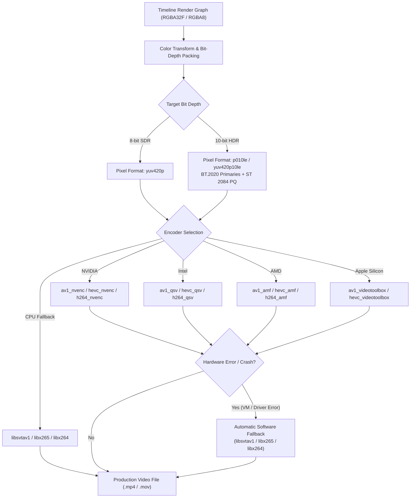

# Reddart Hardware-Accelerated AV1 & HEVC Codec Expansion Architecture

This document specifies the technical architecture, hardware encoder/decoder discovery, 10-bit HDR signaling, rate control models, and resilient fallback mechanisms powering Reddart's expanded media pipeline (`rd_export` and `rd_decode`).

---

## 1. Architectural Motivation

Modern digital video workflows demand support for next-generation delivery and high dynamic range (HDR) cinema formats:
- **AV1 (AOMedia Video 1):** Delivers up to 30–40% bitrate savings compared to H.264/AVC at equivalent subjective visual fidelity, royalty-free licensing, and mandatory adoption across major streaming platforms (YouTube, Netflix, Twitch).
- **HEVC / H.265 (High Efficiency Video Coding):** The global standard for 4K UHD broadcast delivery, HDR10 mastering, and mobile capture formats (Apple iPhone HEVC, Action Cams).
- **10-Bit & 12-Bit HDR Mastery:** Preserving 1.07 billion colors to eliminate visible color banding in fine gradients (skies, sunsets, volumetric lighting) using SMPTE ST 2084 (PQ) and ARIB STD-B67 (HLG) transfer characteristics.
- **Heterogeneous Hardware Acceleration:** Offloading encode and decode workloads to dedicated fixed-function silicon blocks across NVIDIA (NVENC/NVDEC), Intel (QuickSync), AMD (AMF), and Apple (VideoToolbox).



---

## 2. Multi-Vendor Hardware Encoder Suite

Reddart automatically diagnoses and benchmarks the host system's hardware encoding capabilities upon engine startup via `rd_export::probe_hardware_encoders()`.

### 2.1 Hardware Encoder Matrix

| Silicon Vendor | Codec API | H.264 Encoder | HEVC (10-bit) Encoder | AV1 Encoder |
| :--- | :--- | :--- | :--- | :--- |
| **NVIDIA** | NVENC / NVDEC | `h264_nvenc` | `hevc_nvenc` (`p010le`, `main10`) | `av1_nvenc` (Ada Lovelace / Blackwell) |
| **Intel** | QuickSync Video (QSV) | `h264_qsv` | `hevc_qsv` (`p010le`, `main10`) | `av1_qsv` (Arc Alchemist / Meteor Lake+) |
| **AMD** | Advanced Media Framework | `h264_amf` | `hevc_amf` (`p010le`, `main10`) | `av1_amf` (RDNA3 / RX 7000+) |
| **Apple** | VideoToolbox | `h264_videotoolbox` | `hevc_videotoolbox` (Apple Silicon) | `av1_videotoolbox` (M3 / M4) |
| **Software** | CPU Native | `libx264` | `libx265` (`yuv420p10le`) | `libsvtav1` / `libaom-av1` |

### 2.2 Profile-Aware Selection (`select_encoder_for_profile`)
`select_encoder_for_profile(codec, bit_depth)` dynamically evaluates hardware support:
- If 10-bit color depth is requested and the primary hardware encoder does not support 10-bit (or is an older generation card), the pipeline automatically falls back to 10-bit software encoders (`libx265` or `libsvtav1`) to prevent color truncation or driver aborts.
- `supports_10bit(encoder)` maintains the definitive hardware verification predicate.

---

## 3. 10-Bit Color Depth & HDR Metadata Signaling

When exporting HDR or wide-color-gamut timelines:
1. **Pixel Formats:**
   - Hardware encoders (NVENC, QSV, AMF) receive `p010le` (packed 16-bit word with 10-bit MSB alignment).
   - Software encoders (`libx265`, `libsvtav1`) receive planar `yuv420p10le`.
2. **Color Primaries and Transfer Curves:**
   - **HDR10 (PQ):** `-color_primaries bt2020 -color_trc smpte2084 -colorspace bt2020nc`
   - **HLG (Hybrid Log-Gamma):** `-color_primaries bt2020 -color_trc arib-std-b67 -colorspace bt2020nc`
   - **Rec.709 (SDR):** `-color_primaries bt709 -color_trc bt709 -colorspace bt709`
3. **Profile Signaling:**
   - HEVC 10-bit: `-profile:v main10`
   - AV1 10-bit: `-profile:v main` (AV1 Profile 0 supports 8-bit and 10-bit 4:2:0)

---

## 4. Rate Control Modes (`RateControlMode`)

Reddart supports four production rate-control strategies via `RateControlMode`:

```rust
pub enum RateControlMode {
    Cbr,
    Vbr,
    Crf(u32),
    Cvbr { max_bitrate_kbps: u32, bufsize_kbps: u32 },
}
```

The pipeline transparently maps each mode to hardware-specific parameters:
- **`Crf(val)`:**
  - Software (`libx264`, `libx265`, `libsvtav1`): `-crf <val>`
  - NVENC: `-rc vbr -cq <val> -b:v 0`
  - QSV: `-global_quality <val>`
  - AMF: `-rc cqp -qp_i <val> -qp_p <val>`
  - VideoToolbox: `-q:v <val>`
- **`Cbr`:**
  - Enforces strict minimum, maximum, and target bitrates with buffer sizing:
    `-b:v <B> -minrate <B> -maxrate <B> -bufsize <2*B>`
- **`Vbr` / `Cvbr`:**
  - Enforces constrained variable bitrate ceilings for streaming compliance.

---

## 5. Hardware Decoder Diagnostics (`rd_decode`)

`rd_decode::probe_hardware_decoders()` probes low-latency decode acceleration:
- **Direct3D 11 (`d3d11va`) & DXVA2:** Native GPU texture surfaces on Windows.
- **NVIDIA NVDEC (`cuda`):** Dedicated CUDA hardware decode context.
- **Intel QuickSync (`qsv`):** Intel GPU media fixed-function decoder.
- **Apple VideoToolbox (`videotoolbox`):** Apple Silicon CoreVideo decode session.
- **Linux VAAPI (`vaapi`):** DRI/KMS hardware acceleration.

`FfmpegDecoder::set_hwaccel` allows runtime switching between explicit accelerators or automated hardware negotiation.

---

## 6. Automated Verification Suite

The AV1 & HEVC codec expansion subsystem is validated in `crates/rd-export/tests/codec_expansion_av1_hevc_test.rs` and `crates/rd-export/tests/hardware_matrix_test.rs`:

| Test Name | Verified Invariants & Scope |
| :--- | :--- |
| `test_codec_preset_construction_and_rate_control_modes` | Validates construction of all new presets (`av1_1080p`, `av1_4k`, `hdr10_hevc_4k`, `hdr10_av1_4k`, `mastering_prores_422`) and builder chaining (`with_bit_depth`, `with_color_space`, `with_rate_control`). |
| `test_10bit_encoder_selection_and_support_predicate` | Verifies 10-bit capability predicates for NVENC, AMF, QSV, VideoToolbox, SVT-AV1, x265, and ProRes. |
| `test_hardware_decoder_report_and_probe` | Validates FFmpeg hardware decode probe diagnostics across D3D11VA, DXVA2, CUDA, QSV, VideoToolbox, and VAAPI. |
| `test_codec_serialization_roundtrip` | Verifies bit-for-bit JSON serialization and deserialization of presets with custom bit depths and rate control modes. |
| `test_render_to_file_av1_and_hevc_presets` | Encodes synthesized media using both HEVC and AV1 encoders; probes resulting MP4 containers to verify valid video/audio streams and exact frame dimensions. |
| `test_rate_control_mode_crf_and_cbr_export` | Verifies encoding and container validity under explicit CBR rate control mode. |
| `test_hardware_encoder_probing_and_selection` | Verifies multi-vendor hardware encoder discovery, tier selection, and codec selection invariants across H.264, HEVC, and AV1. |
