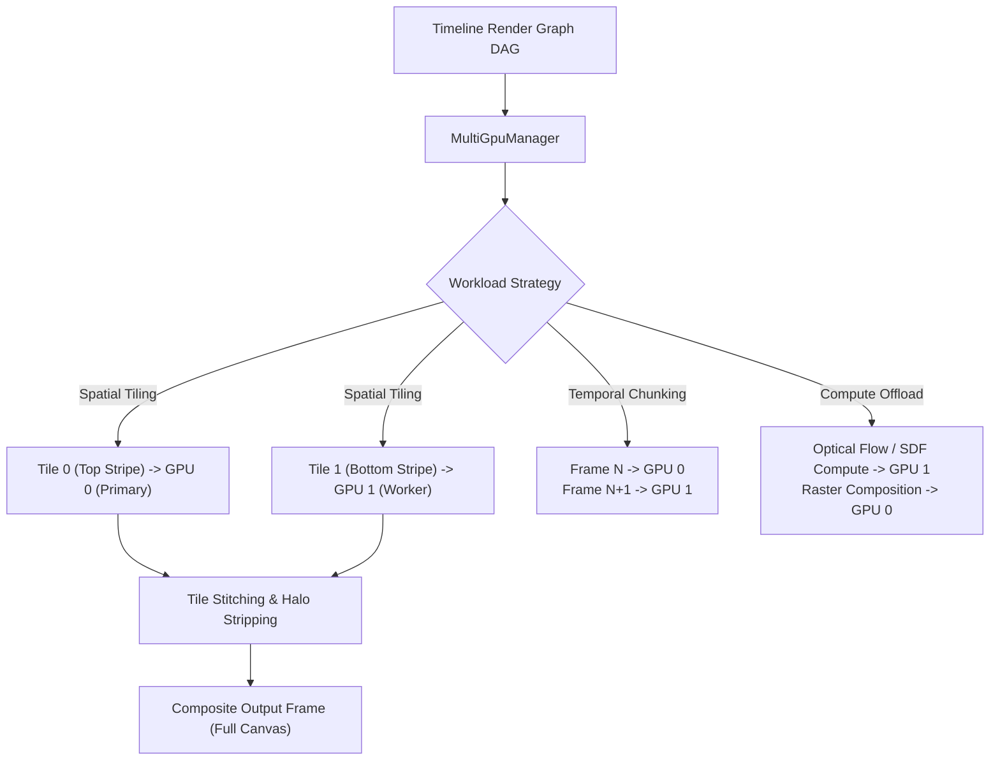

# Reddart Multi-GPU Distributed Rendering & Peer-to-Peer Interconnect Architecture

This document specifies the technical architecture, workload partitioning strategies, peer-to-peer (P2P) memory coordination, and frame stitching mechanisms powering Reddart's multi-adapter rendering engine.

---

## 1. Architectural Motivation

Modern high-resolution timeline editing (4K UHD $3840 \times 2160$, 6K DCI $6144 \times 3240$, and 8K UHD $7680 \times 4320$) at high frame rates (60–120 fps) imposes extreme compute and memory bandwidth loads on single graphics adapters:

- **Raw Pixel Throughput:** An 8K UHD 60 fps RGBA32F stream requires processing over **1.99 billion pixels per second**, translating to $\sim 31.8\text{ GB/s}$ of continuous uncompressed texture bandwidth.
- **Compute Shader Density:** Multi-pass compute operations (such as Horn-Schunck optical flow estimation, Felzenszwalb & Huttenlocher 2D Euclidean Distance Transform for vector text, and bilateral occlusion synthesis) scale quadratically with canvas area.

Reddart addresses this through a modular **Multi-GPU Fleet Management Subsystem** (`rd_render::multi_gpu`), enabling heterogeneous multi-adapter acceleration across NVIDIA (NVLink / SLI), AMD (xGMI / CrossFire), Intel, and unified memory architectures.



---

## 2. Fleet Discovery & Hardware Classification

Upon engine initialization, `MultiGpuManager::discover` enumerates all available physical adapters across all supported backends (DirectX 12, Vulkan, Metal) using `wgpu::Instance::enumerate_adapters`.

### Adapter Profiles (`GpuAdapterProfile`)
Each recognized GPU is profiled with the following metadata:
- **`id`:** Monotonic adapter index within the fleet.
- **`name`:** Hardware model descriptor string.
- **`backend`:** Active graphics API (Vulkan, DX12, Metal).
- **`device_type`:** Adapter class (`DiscreteGpu`, `IntegratedGpu`, `Cpu`, `VirtualGpu`).
- **`vram_bytes`:** Dedicated video memory capacity.
- **`interconnect`:** Hardware interconnect protocol classification.
- **`role`:** Designated operational role (`Primary`, `SecondaryCompute`, `TileWorker`).

### Interconnect Classification
Adapters are categorized into four interconnect hierarchies:
1. **`NvLink` / `xGMI`:** High-bandwidth direct peer-to-peer bridge ($> 200\text{ GB/s}$). Supports zero-latency device-to-device memory copies bypassing the host CPU.
2. **`PcieP2p`:** Direct PCIe DMA across PCIe root complex or switch switches ($> 32\text{ GB/s}$).
3. **`UnifiedMemory`:** Shared physical system and graphics memory architecture (Apple Silicon Unified Memory, AMD APU, Intel Iris/Arc Xe). Zero-copy buffer sharing between CPU and GPU.
4. **`HostPinnedMemory`:** Intermediate system RAM staging fallback ($< 16\text{ GB/s}$) when direct P2P access is unavailable.

---

## 3. Workload Partitioning Strategies

Reddart supports three distinct multi-adapter workload strategies configured via `WorkloadPartitionStrategy`:

### 3.1 Split-Frame Spatial Tiling (`SpatialTiling`)
For ultra-high-resolution canvases, the frame is sliced into horizontal stripes:
- **Tile Count:** Configured to match active discrete GPUs ($N = 2, 3, 4$).
- **Halo Margin:** Slices include a configurable boundary margin (`halo_pixels`, typically 8–16 px) extending above and below the target slice.
- **Boundary Clamping:** Halos are automatically clamped at the canvas edges ($y=0$ and $y=\text{height}$) so tiles never sample outside valid coordinates.
- **Odd Dimension Handling:** Canvas heights not evenly divisible by tile count allocate the integer remainder to the final tile ($H_i = \lfloor H/N \rfloor$, with $H_{N-1} = \lfloor H/N \rfloor + (H \bmod N)$), ensuring bit-for-bit complete pixel coverage.

```
+-------------------------------------------------------+
| Tile 0: Render Y=0..1096  | Target Y=0..1080 (Top)    |
| (Halo bottom: 16px)                                   |
+-------------------------------------------------------+
| Tile 1: Render Y=1064..2160 | Target Y=1080..2160 (Btm)|
| (Halo top: 16px)                                      |
+-------------------------------------------------------+
```

### 3.2 Alternate Frame Temporal Chunking (`TemporalChunking`)
For real-time timeline playback and high-throughput video export:
- Frames are scheduled round-robin in contiguous chunks of $K$ frames:
  $$\text{Adapter Index} = \left\lfloor \frac{\text{Frame Index}}{K} \right\rfloor \bmod N_{\text{adapters}}$$
- Maximizes hardware video encoding pipe utilization (NVENC, AMF, QuickSync) across multiple discrete cards.

### 3.3 Dedicated Compute Offload (`ComputeOffload`)
- Offloads heavy asynchronous compute passes (such as Horn-Schunck optical flow motion vector estimation and 2D Euclidean Distance Transform text field generation) to a secondary discrete GPU.
- Primary GPU remains dedicated to viewport rasterization, UI compositing, and display swapchain presentation without frame drops.

---

## 4. Tile Stitching & Halo Stripping

`MultiGpuManager::stitch_frame_tiles` reconstructs the final composite canvas from rendered tile buffers:
1. **Size & Dimension Validation:** Ensures buffer lengths match $(\text{render\_width} \cdot \text{render\_height} \cdot 4)$ bytes.
2. **Halo Stripping:** Offsets source row pointers past `halo_top` and `halo_left`, extracting strictly the canonical target region.
3. **Row-by-Row Direct Blit:** Copies the target rows into the composite frame buffer at destination coordinates $(X, Y)$, maintaining bit-for-bit parity with single-GPU ground truth rendering.

---

## 5. Automated Verification Suite

The multi-GPU distributed rendering architecture is verified in `crates/rd-render/tests/multi_gpu_distributed_render_test.rs`:

| Test Case | Scope & Invariants Verified |
|---|---|
| `test_multi_adapter_discovery_and_role_assignment` | Discovery of heterogeneous fleet, discrete primary selection, secondary compute allocation, and interconnect classifications. |
| `test_spatial_frame_partition_and_halo_geometry` | 4K UHD spatial partition into 2 tiles, verifying boundary clamping ($y=0$ top halo = 0; $y=2160$ bottom halo = 0). |
| `test_spatial_frame_stitching_bit_for_bit` | Synthetic gradient pattern partitioned across tiles, rendered with halos, stitched, and compared against ground truth (MSE = 0.000000). |
| `test_odd_dimensions_and_remainder_handling` | Partitioning 1081px odd-height frame across 3 tiles ($360 + 360 + 361 = 1081$), verifying total vertical coverage. |
| `test_temporal_frame_scheduling_round_robin` | Round-robin chunk scheduling ($K=2$) across 3 adapters over sequential timeline frames. |
| `test_compute_offload_decision` | Compute offload heuristics verifying delegation to secondary discrete GPU and fallback on single-GPU fleets. |
| `test_single_gpu_fallback_graceful_degradation` | Transparent fallback to full-frame single-tile rendering when multi-GPU is disabled or unavailable. |
| `test_multi_gpu_error_conditions` | Rejection of zero-dimension frames, truncated tile buffers, and out-of-bounds tile descriptors. |
