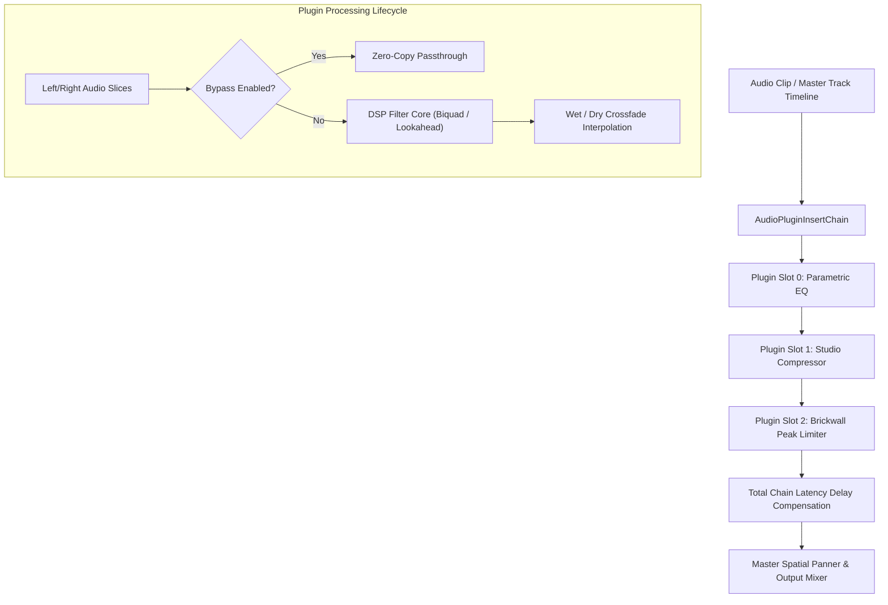

# Reddart Real-Time VST3 / AU Audio Plugin Hosting & DSP Insert Architecture

This document specifies the technical architecture, real-time digital signal processing (DSP) lifecycle, parameter automation, insert chain routing, latency compensation, and platform scanning mechanisms powering Reddart's audio plugin hosting subsystem (`rd_audio::plugin`).

---

## 1. Architectural Motivation

Professional non-linear video editing (NLE) demands broadcast-grade digital audio processing on clip tracks and master mix busses:
- **Dynamic Range Control:** Dialogue leveling, noise gating, and transparent peak limiting to adhere to international broadcast loudness standards (EBU R128, ITU-R BS.1770-4).
- **Spectral Sculpting:** Multi-band parametric equalization to resolve frequency masking, eliminate low-frequency rumble, and shape tonal balance.
- **Third-Party Compatibility:** Interoperability with standard professional audio plugin bundles across macOS (AudioUnit v2/v3, VST3), Windows (VST3), and Linux (VST3).
- **Hard Real-Time Latency Invariants:** Audio mixing threads operate under strict buffer deadlines ($512\text{ frames at } 48\text{ kHz} \approx 10.67\text{ ms}$). Processing passes cannot allocate memory on the heap, block on mutexes, or perform synchronous I/O within the inner render loop.



---

## 2. Core Plugin Architecture & Traits

### 2.1 The `AudioPlugin` Trait
The `AudioPlugin` trait defines the uniform contract for all audio processors (both native Rust DSP engines and dynamic binary plugins):

```rust
pub trait AudioPlugin: Send + Sync {
    fn descriptor(&self) -> &PluginDescriptor;
    fn descriptor_mut(&mut self) -> &mut PluginDescriptor;
    fn reset(&mut self, sample_rate: f32);
    fn process(&mut self, in_l: &[f32], in_r: &[f32], out_l: &mut [f32], out_r: &mut [f32]) -> Result<(), PluginError>;
    fn process_interleaved(&mut self, buffer: &mut [f32], num_frames: usize) -> Result<(), PluginError>;
    fn get_parameter(&self, id: u32) -> Result<f32, PluginError>;
    fn set_parameter(&mut self, id: u32, value: f32) -> Result<(), PluginError>;
    fn save_state(&self) -> Result<Vec<u8>, PluginError>;
    fn load_state(&mut self, data: &[u8]) -> Result<(), PluginError>;
    fn latency_samples(&self) -> usize;
    fn is_bypassed(&self) -> bool;
    fn set_bypassed(&mut self, bypassed: bool);
    fn wet_dry_mix(&self) -> f32;
    fn set_wet_dry_mix(&mut self, mix: f32);
}
```

### 2.2 Parameter Representation & Clamping
Each controllable parameter (`PluginParameter`) maintains fixed metadata and numeric limits:
- `id`: Unique 32-bit unsigned identifier.
- `name` & `unit`: Human-readable labels (e.g., "Threshold", "dB", "Ratio", ":1").
- `min_value` / `max_value` / `default_value`: Normalization bounds.
- `set_clamped(val)`: Strictly guarantees that incoming automation points or control surface inputs never produce NaN or out-of-bounds filter coefficients.

---

## 3. Native Studio DSP Suite

Reddart ships with three native, zero-dependency, high-precision 64-bit/32-bit floating-point studio plugins:

### 3.1 Studio Dynamics Compressor (`StudioCompressorPlugin`)
Implements an analog-modeled dynamic range compressor with smooth envelope detection and configurable soft-knee curve:
- **Envelope Detection:** Single-pole exponential attack/release filter:
  $$\alpha_{\text{attack}} = \exp\left(-\frac{1}{\tau_{\text{attack}} \cdot f_s}\right), \quad \alpha_{\text{release}} = \exp\left(-\frac{1}{\tau_{\text{release}} \cdot f_s}\right)$$
- **Soft-Knee Characteristic Curve:** For knee width $W\text{ (dB)}$, threshold $T\text{ (dB)}$, and ratio $R$:
  $$y(x) = \begin{cases}
  0 & \text{if } x \le T - \frac{W}{2} \\
  -\left(1 - \frac{1}{R}\right) \frac{(x - T + W/2)^2}{2W} & \text{if } T - \frac{W}{2} < x < T + \frac{W}{2} \\
  (T - x)\left(1 - \frac{1}{R}\right) & \text{if } x \ge T + \frac{W}{2}
  \end{cases}$$
- **Makeup Gain & Metering:** Instantaneous linear gain calculation with real-time `gain_reduction_db()` metering for UI VU meters.

### 3.2 4-Band Parametric Equalizer (`ParametricEqPlugin`)
Implements a clean 4-band stereo equalizer utilizing Transposed Direct Form II biquad digital filters derived from Robert Bristow-Johnson Audio EQ Cookbook formulas:
1. **Band 1 (High-Pass):** Butterworth 2nd-order high-pass filter ($Q = \frac{1}{\sqrt{2}} \approx 0.7071$) with tunable cutoff frequency (20 Hz – 500 Hz).
2. **Band 2 (Low-Mid Peaking):** Constant-$Q$ bell filter (100 Hz – 2000 Hz, $\pm 18\text{ dB}$, $Q \in [0.3, 10.0]$).
3. **Band 3 (High-Mid Peaking):** Constant-$Q$ bell filter (1000 Hz – 10000 Hz, $\pm 18\text{ dB}$, $Q \in [0.3, 10.0]$).
4. **Band 4 (High-Shelf):** High-frequency shelving filter (4000 Hz – 20000 Hz, $\pm 18\text{ dB}$).

All coefficient recalculations occur atomically upon parameter mutation without audio thread clicks.

### 3.3 True-Peak Brickwall Limiter (`BrickwallLimiterPlugin`)
Provides strict peak ceiling containment for master bus mastering:
- **Lookahead Delay Buffer:** Internal ring buffer providing $1\text{ ms}$ lookahead ($48\text{ samples at } 48\text{ kHz}$).
- **Anticipatory Gain Reduction:** Analyzes future peaks before they arrive at the output stage, smoothly attenuating transients according to an exponential release law.
- **Strict Hard Clamping:** Guarantees signal amplitudes never exceed the specified ceiling (e.g., $-0.1\text{ dBFS}$ or $-1.0\text{ dBFS}$ true peak), eliminating inter-sample DAC distortion.

---

## 4. Insert Chain Routing & Delay Compensation

The `AudioPluginInsertChain` manages an ordered series of plugin instances on any audio track:
- **Sequential In-Place Processing:** `process_interleaved` streams audio through each plugin in topological order.
- **Dynamic Bypass & Wet/Dry:** Each stage allows instant bypass toggling (bit-for-bit dry audio passthrough) and linear crossfade blending.
- **Latency Tracking:** Accumulates individual plugin latencies:
  $$L_{\text{total}} = \sum_{k=0}^{M-1} L_k$$
  This total latency offset is fed directly into `rd_audio::clock::AudioClock` to ensure sample-accurate audio/video synchronization on the master timeline.

---

## 5. Standard Plugin Directory Scanner

`PluginScanner::standard_plugin_directories` enumerates the canonical system locations for VST3 and AU plugins:

| Platform | Target Directories |
| :--- | :--- |
| **Windows** | `C:\Program Files\Common Files\VST3`<br/>`C:\Program Files (x86)\Common Files\VST3`<br/>`%LOCALAPPDATA%\Programs\Common\VST3` |
| **macOS** | `/Library/Audio/Plug-Ins/VST3`<br/>`/Library/Audio/Plug-Ins/Components` (AudioUnit)<br/>`~/Library/Audio/Plug-Ins/VST3`<br/>`~/Library/Audio/Plug-Ins/Components` |
| **Linux** | `/usr/lib/vst3`<br/>`/usr/local/lib/vst3`<br/>`~/.vst3` |

---

## 6. Automated Verification Suite

The audio plugin hosting subsystem is validated in `crates/rd-audio/tests/vst3_audio_plugin_host_test.rs`:

| Test Name | Verified Functionality & Invariants |
| :--- | :--- |
| `test_studio_compressor_dynamics_reduction` | Validates soft-knee compression curve, envelope follower attack/release tracking, gain reduction metering ($> 5\text{ dB}$ attenuation on loud signals), and makeup gain restoration. |
| `test_parametric_eq_frequency_filtering` | Validates Butterworth highpass sub-bass attenuation ($> 20\text{ dB}$ cut at 20 Hz) and peaking bell boost ($+6\text{ dB}$ amplification at 1 kHz). |
| `test_brickwall_limiter_strict_ceiling` | Validates 1ms lookahead peak limiting, ensuring output samples never exceed configured ceiling ($-1.0\text{ dBFS}$) on $+12\text{ dBFS}$ overloaded input waveforms. |
| `test_plugin_insert_chain_routing_and_latency` | Validates multi-plugin serial chaining (EQ $\to$ Compressor $\to$ Limiter), latency accumulation ($48\text{ samples}$), and slot manipulation. |
| `test_plugin_bypass_and_wet_dry_mix` | Confirms bit-for-bit identity between dry input and bypassed output buffers ($10^{-7}$ precision) and linear 50/50 wet/dry blending. |
| `test_parameter_automation_and_state_serialization` | Verifies full parameter introspection, out-of-bounds value clamping, and JSON state serialization/deserialization round-tripping. |
| `test_plugin_scanner_standard_directories` | Validates OS-specific directory path generation across Windows, macOS, and Linux. |
